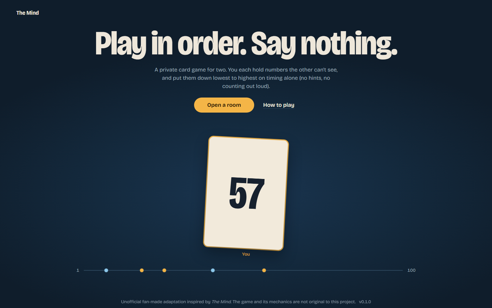
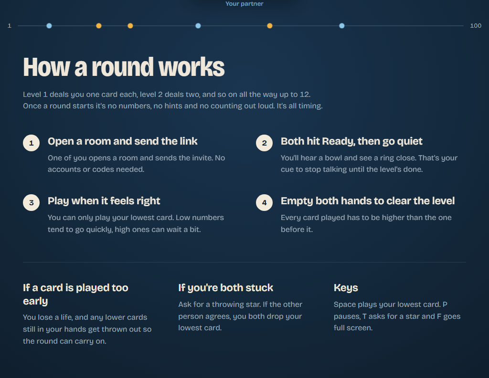
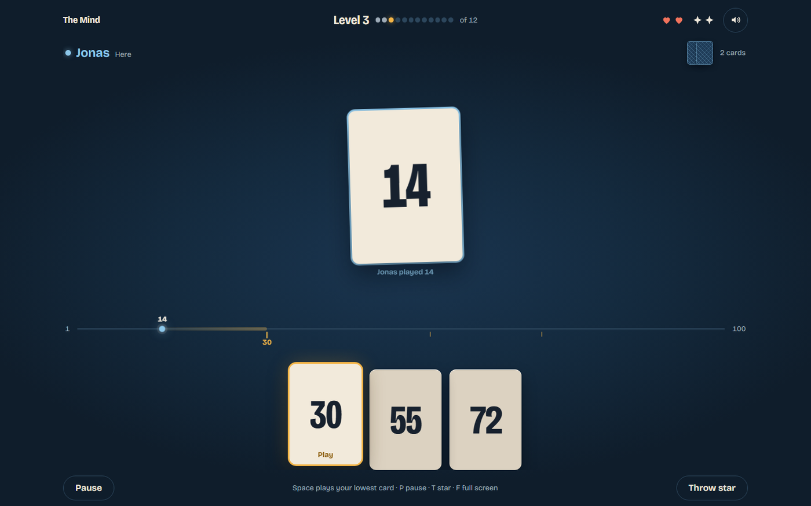
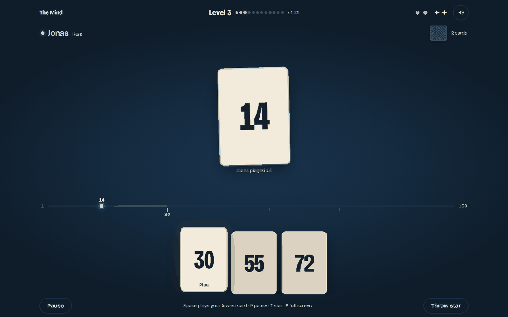
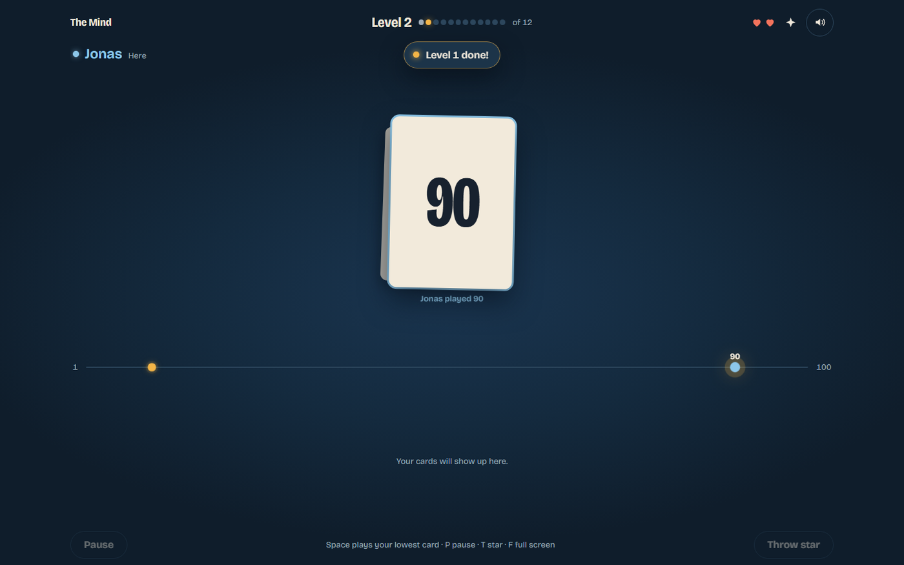

# The Mind

A private, real-time version of *The Mind* for two people.

Open a room, send one link and get quiet. You each hold numbers the other can't see, and you try to play every card lowest to highest without saying a word.

**Play it here:** https://the-mind-online.hephyz.workers.dev



## What this is for

I built this so two people can play a tense little timing game from anywhere, usually while already on a call, with as little setup as possible:

- one private room
- one invite link
- no accounts and no lobby codes
- works on phones and laptops

## How to play



1. One of you opens a room and sends the invite link.
2. When you're both in, press `Ready`.
3. A bowl sounds and a ring closes. That's the cue to stop talking.
4. You can only see your own cards, and you can only play your lowest one.
5. Cards have to be played in rising order across both hands.
6. If a card is played while a lower one is still held, you lose a life and the lower cards are thrown out.
7. If you're both stuck, one of you can ask for a `Throwing star`. If the other agrees, you both drop your lowest card.
8. Empty both hands to clear the level. Level 1 deals one card each, level 2 deals two, and so on.
9. Clear level 12 to finish the run.

## The table

### A clean round


Ready up, go quiet during the focus ring, play, and clear the level together.

### The number line



The line under the pile runs from 1 to 100. Every played card gets a dot, amber for yours and blue for your partner's, and your own cards hang underneath as ticks. The shaded stretch is the gap between the last card played and your lowest card, which is basically what you're counting in your head anyway.

Cards fly onto the pile from below when you play them and from above when your partner does, so you can tell who played without reading anything.

### When a card is played too early



You lose a life straight away and the card that broke the order is outlined in coral.

### Level clear



### Mobile


## Sound

Everything is made with the Web Audio API, so there are no sound files.

- Every card plays a note pitched by its number, on a scale where any two notes sound fine together. A clean round climbs like a little melody.
- Your partner's cards sound slightly further away than yours, so with headphones you can hear that they played.
- A card played too early breaks the melody with a low drop and a clashing pair of notes.
- Clearing a level replays the notes you just played together, and the dots on the line light up in time.
- A bowl marks the start of the focus countdown and a chime marks the moment you can play.
- You hear your partner join or leave, and a request from them asks for your attention.
- There's an optional low room tone during rounds. Sound and room tone can both be switched off in settings (the speaker button, top right).

Browsers only allow sound after you've clicked or tapped the page once, so the very first moment can be silent.

To hear every cue without playing a game:

```bash
node scripts/render-sound-cues.mjs
```

That writes a WAV file per cue, plus their levels, to `output/sound-cues/`.

## Controls

| Input | Action |
| --- | --- |
| `Space` | Play your lowest card |
| `P` | Ask to pause |
| `T` | Ask for a throwing star |
| `F` | Toggle full screen |

## Attribution

This is an unofficial fan-made adaptation inspired by *The Mind*. The game and its mechanics are not original to this project.

## Stack

- React 19
- Vite 7
- Motion
- Hono
- Cloudflare Workers
- Durable Objects
- Zod
- Zustand
- Bricolage Grotesque (self-hosted through Fontsource)
- Playwright

## Run locally

Install dependencies:

```bash
npm install
```

Run the full multiplayer stack locally:

```bash
npm run dev:edge
```

Then open:

```text
http://127.0.0.1:4173/
```

`npm run dev` still exists for a quick frontend loop, but use `npm run dev:edge` for real room testing because it runs the Worker and Durable Object stack.

## Test

```bash
npm run lint
npm run typecheck
npm run test:unit
npm run test:worker
npm run test:e2e
```

GitHub Actions runs all of these on every push to `main` and on pull requests.

## Deploy

The app runs on Cloudflare Workers. Pushing to GitHub doesn't deploy it, so after changes run:

```bash
npm run build
npm run deploy
```

You'll need to be logged in first (`npx wrangler login`). The live URL is:

```text
https://the-mind-online.hephyz.workers.dev
```

## README images

The screenshots and GIFs above come from the running app. With `npm run dev:edge` going:

```bash
node scripts/generate-readme-assets.mjs
python scripts/finalize-readme-assets.py
```
