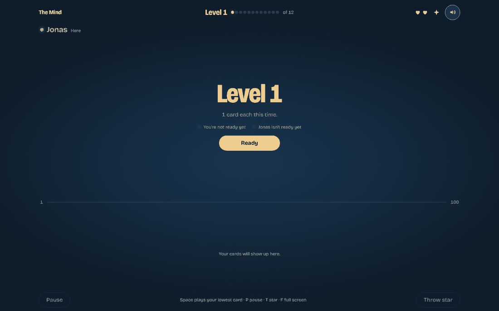
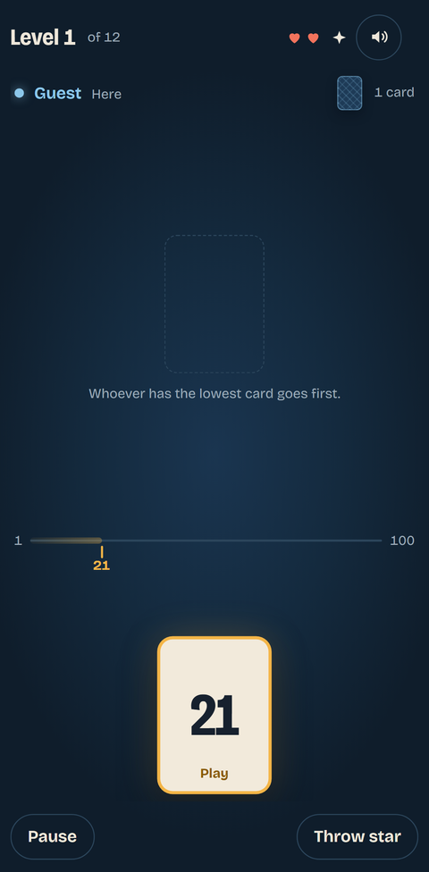

<div align="center">

# The Mind

**A private, real-time version of *The Mind* for two people.**

Open a room, send one link and get quiet.

<a href="https://the-mind-online.hephyz.workers.dev"></a>
&nbsp;
<a href="https://github.com/Heps-akint/the-mind/actions/workflows/ci.yml"></a>

<br>


</div>

<br>

## Contents

- [Why I made this](#why-i-made-this)
- [How to play](#how-to-play)
- [What you'll see](#what-youll-see)
- [Sound](#sound)
- [Controls](#controls)
- [Running it yourself](#running-it-yourself)
- [Attribution](#attribution)

<br>

## Why I made this

I wanted a way to play *The Mind* with someone who isn't in the same room as me. Most of the time we're already on a call, so the last thing I wanted was sign-ups, lobby codes or anything else to sort out before we could start.

So this is about as simple as I could make it:

- one private room
- one invite link
- no accounts
- works on your phone or laptop

<br>

## How to play

You each get some numbered cards (1 to 100) that only you can see. Between you, you have to play every card onto one pile from lowest to highest, without talking. That's it really, the hard part is the timing.

1. **Open a room** and send the invite link to the other person.
2. When you're both in, press **Ready**.
3. A bowl sounds and a ring closes on screen. That's your cue to stop talking.
4. **Play your lowest card when it feels right.** You can only ever play your lowest one.
5. Every card played has to be higher than the one before it, across both hands.
6. **Empty both hands to clear the level.** Level 1 deals one card each, level 2 deals two, and so on up to 12.

> [!TIP]
> No hints, no counting out loud and no "are you going?". Low numbers tend to go quickly and high ones can wait a bit, but past that you're reading each other.

### When something goes wrong

| What happened | What it costs |
| --- | --- |
| A card is played while a lower one is still in someone's hand | You lose a life, and the lower cards get thrown out so the round can carry on |
| You're both stuck and nobody wants to go | One of you asks for a **throwing star**. If the other agrees, you both drop your lowest card |
| You run out of lives | The run ends. Press **Rematch** for fresh cards in the same room |

You start with 2 lives and 1 throwing star. Clearing levels 2, 5 and 8 earns another star, and clearing levels 3, 6 and 9 earns another life.

<br>

## What you'll see

### A clean round



Ready up, go quiet while the ring closes, play, and clear the level together.

### The table


The line under the pile runs from 1 to 100, and it's probably the bit I like most:

- every card played gets a dot on the line
- your own cards hang underneath it as ticks
- the shaded stretch is the gap between the last card played and your lowest card (which is basically what you're counting in your head anyway)

Colours always mean the same thing, so you can read the table at a glance:

| Colour | Means |
| --- | --- |
| 🟡 Amber | You: your cards, your dots, the card you can play |
| 🔵 Blue | The other person: their name, their cards, their dots |
| 🔴 Coral | A lost life |

Cards also fly onto the pile from below when you play them and from above when the other person does, so you can tell who played without reading anything.

### When a card is played too early


### On your phone

<table>
  <tr>
    <td width="34%"></td>
    <td>
      The whole table fits on one screen with no scrolling, down to a 320 by 568 phone.
      <br><br>
      Tap your card to play it. Your name, sound and room tone are in the settings menu (the speaker button, top right).
    </td>
  </tr>
</table>

<br>

## Sound

Sound does a lot of the work here, since you're meant to be looking at your cards and not reading text. It's all generated in the browser, so there are no audio files.

| You hear | It means |
| --- | --- |
| A soft note | A card was played. Higher cards play higher notes, so a clean round climbs like a little melody |
| The same note, but further away | The other person played (easiest to notice with headphones) |
| A low drop and two notes clashing | A card was played too early and you lost a life |
| A bowl | The focus countdown has started, so stop talking |
| One clear high note | The round is live and you can play |
| Your notes replayed in order | You cleared the level, and the dots on the line light up along with it |
| A rising or falling pair of notes | The other person joined or left |
| Three bright notes | The other person wants to use a throwing star, so you need to answer |

There's also an optional low hum while you play. You can switch it off, or turn sound off completely, in settings.

> [!NOTE]
> Browsers only allow sound once you've clicked or tapped the page, so the very first moment can be silent. Pressing **Ready** sorts it.

<br>

## Controls

| Key | What it does |
| --- | --- |
| <kbd>Space</kbd> | Play your lowest card |
| <kbd>P</kbd> | Ask to pause |
| <kbd>T</kbd> | Ask for a throwing star |
| <kbd>F</kbd> | Toggle full screen |

On a phone, just tap.

<br>

## Running it yourself

<details>
<summary><strong>What it's built with</strong></summary>

<br>

- React 19, Vite 7 and Motion for the frontend
- Hono, Cloudflare Workers and Durable Objects for rooms and real-time play
- Zod for checking every message between the browser and the server
- Zustand for client state
- Bricolage Grotesque for the type, self-hosted through Fontsource
- Vitest and Playwright for tests

The game rules live in one shared engine (`src/shared/game-core.ts`), and the server is the only thing allowed to change the game state. The browser just shows it.

</details>

<details>
<summary><strong>Run it locally</strong></summary>

<br>

```bash
npm install
npm run dev:edge
```

Then open http://127.0.0.1:4173/.

`npm run dev` is still there for a quick frontend loop, but use `npm run dev:edge` if you want to actually play, since it runs the Worker and Durable Objects as well.

</details>

<details>
<summary><strong>Tests</strong></summary>

<br>

```bash
npm run lint
npm run typecheck
npm run test:unit
npm run test:worker
npm run test:e2e
```

GitHub Actions runs all of these on every push to `main` and on pull requests.

</details>

<details>
<summary><strong>Deploying</strong></summary>

<br>

It runs on Cloudflare Workers. Pushing to GitHub doesn't deploy it, so after any changes:

```bash
npx wrangler login   # only needed the first time
npm run build
npm run deploy
```

The live site is https://the-mind-online.hephyz.workers.dev.

</details>

<details>
<summary><strong>Listening to every sound</strong></summary>

<br>

```bash
node scripts/render-sound-cues.mjs
```

This renders each sound to a WAV file in `output/sound-cues/`, along with how loud each one is, so you can hear them without playing a game.

</details>

<details>
<summary><strong>Updating the screenshots in this README</strong></summary>

<br>

With `npm run dev:edge` running:

```bash
node scripts/generate-readme-assets.mjs
python scripts/finalize-readme-assets.py
```

</details>

<br>

## Attribution

This is an unofficial fan-made adaptation inspired by *The Mind*. The game and its mechanics aren't original to this project.
